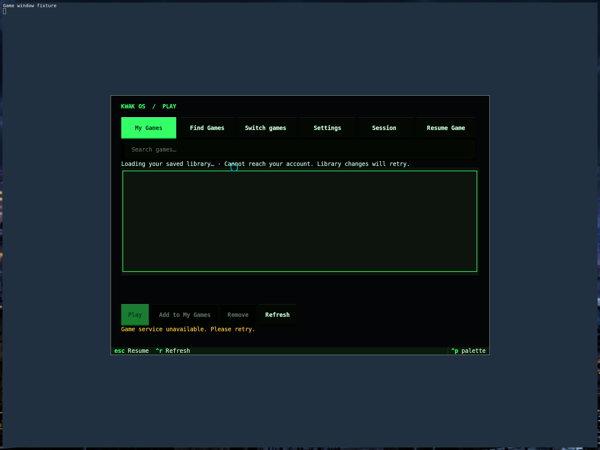
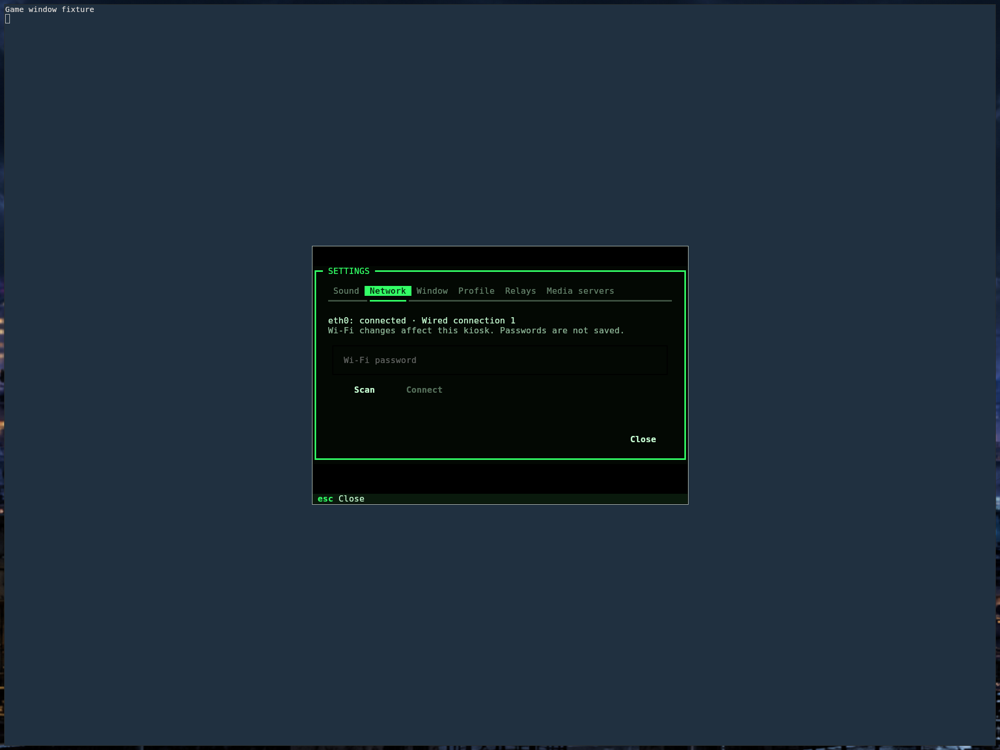
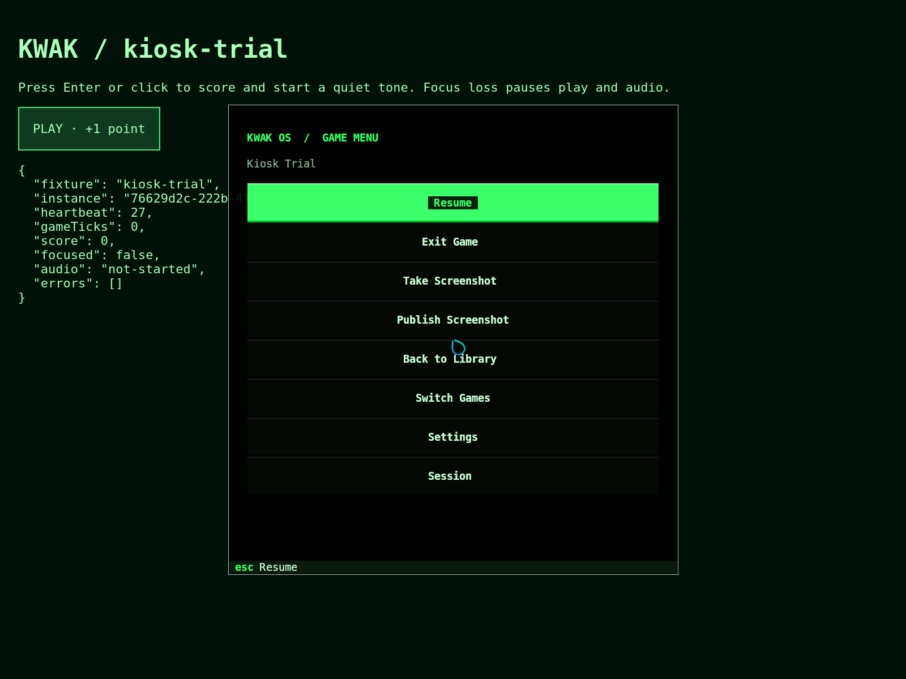

# Game kiosk implementation

The agreed experience is a public kiosk: swipe a Nostr card, see your game
library immediately, download missing games concurrently, and play each when
ready. Accounts remain temporary by default, retaining the existing greeter
option for persistence. New Unix sessions open the library; swiping back to an
existing session resumes its current position.

All system interfaces use the existing green Textual theme with mouse and
keyboard controls. The library and store provide primary navigation. Windows
opens a system overlay; Super+Q opens a terminal as an escape hatch. Hyprflow
provides workspace selection between running applications. Transparent kitty
backgrounds are used for the overlay. Focus loss is the requested game pause
behavior for the overlay; it does not guarantee resource suspension.

## First implemented slice

`apps/kiosk` provides My Games, Find Games, local search, paginated catalog
loading, Install, Play, and Play Now. It uses the pinned kwakore package's
`kwak --json` CLI, retaining its socket ownership, peer validation, protocol
checks, and canonical address handling. Network operations run outside the UI
thread. Failed reads display an error instead of an empty-library message.
Install operations for different games can run concurrently; there is no
invented percentage because the current API returns a final outcome only.

Both the initial runtime pin `b4f95e558eff7f8be20d8373e35c5be3145c4759`
and the current pin `b8990c3e8f61f24b94450736ffeb0dcac080fde3` support `napplet.try`: verified game files are downloaded into memory, no
installed record or desktop entry is created, and a trial window is launched.
The runtime exposes discovery, installed records, launch, and window listing
through its version 1 control protocol. No runtime source changes are needed
for this first slice.

The Nix package installs `kwak-kiosk` and `kwak-overlay`. Nostr desktop startup
opens the library on workspace 1. The overlay is a separate game menu: Resume,
Exit Game, Take Screenshot, Publish Screenshot, Back to Library, Switch Games
through Hyprflow, Settings, and Session. It contains no game catalog or library
rows. Publishing requires a confirmation with the saved filename, dimensions,
and optional caption; Cancel is focused by default. Per-session locks
prevent duplicate library or overlay windows. Existing administrator and ISO
startup behavior is retained. Super+E no longer opens the file manager.

### Game screenshots

Screenshot actions belong to the game that was active before the system overlay
opened. The overlay checks the process owner, executable, PID start time and
compositor window identity. Installed games expose an opaque
`KWAKORE_INSTANCE_ID` matching the runtime windows list and use the exact stop
RPC. Play Now games expose a numeric renderer ID instead, so Exit Game closes
only that verified compositor window. Both retain the canonical game address
without trusting the title or affecting another running game.
The current runtime has no capture RPC, so the kiosk captures through the
compositor after hiding the overlay. A screenshot must contain the game rather
than the system menu.

The account service exposes `publish_screenshot` with `filename`, `caption`,
and the game's canonical `game` address. Publication is a separate user action
from local capture. Files are read only from the requesting account's
`~/.local/share/kwak/screenshots` directory: each path component is opened
without following symlinks, and the PNG must be a regular file owned by that
account, no larger than 16 MiB or 40 million pixels. Captions are limited to
1000 characters. The request cannot choose another account or an arbitrary
file path, and the kiosk gains no generic signing permission.

Publication uses the account's media servers and write relays. The backend
signs a Blossom kind-24242 authorization bound to the PNG's hash, uploads it
over HTTPS, and checks the returned hash, size and URL origin. Upload redirects
are refused. It then signs a kind-1 note containing the caption and image URL,
`imeta` image metadata, and an `a` tag pointing to the game. The same held or
bunker identity signs relay authentication when needed. Success requires a
relay acknowledgment; no key or bunker credential is returned to the overlay.

The local [real-game fixture](../tests/napplet-fixture.md) includes a trusted
HTTPS Blossom upload endpoint and media-server event, allowing screenshot
publication tests without posting to external servers.

## Synced library and session pause

The account service reads and publishes NIP-78 kind 30078 with
`tags: [["d", "kwak-napplets"]]` and JSON content
`{"version":1,"napplets":["35129:PUBLIC_KEY:IDENTIFIER"]}`. The list contains
canonical game addresses, never machine paths or download status. It uses the
user's NIP-65 write relays and configured fallback relays. Reads validate event
IDs/signatures and select the latest event, breaking timestamp ties by lowest
ID. Unsupported content stops mutation rather than being overwritten. The
service remembers validated events during the session to avoid regressing to
an older relay copy. Writes merge one addition/removal into the latest fetched
list under a per-user lock, sign with the session identity, and require at least
one relay OK. NIP-42 challenges are signed by that same identity.

`apps/kiosk/library.py` stores a private cached list and pending delta queue
under `$XDG_STATE_HOME/kwak/library`. Short file locks protect changes from
multiple interfaces; a separate nonblocking sync lock serializes network
retries. Acknowledgments clear only the matching intent, preserving new changes
made while publication was underway. The kiosk retries every 30 seconds.
A failed initial read is a loading/error state, not an empty library. Cached
and pending game rows remain usable when the network fails.

My Games uses this saved list, shows missing games immediately, downloads them
concurrently, enables Play after installation completes, and exposes failed
installs for manual retry via Refresh. The store offers Play Now and Add to My
Games. Removal is explicitly confirmed and changes the saved list everywhere;
it leaves downloaded cache files alone. The session menu attempts pending sync
for five seconds before offering Wait and retry or End session anyway. Ending
a temporary account still uses the existing deletion lifecycle.

A confirmed empty My Games view shows catalog suggestions with Play Now and
Add to My Games. Trials leave the saved list unchanged; adding a suggestion
replaces the recommendations with the saved game and starts its download.
Failed or unfinished library reads never trigger recommendations. These are
catalog suggestions, without a popularity ranking or personalized scoring.

Settings has a Sound tab with the current output volume, mute/unmute, refresh,
and five-percent increments. Increases are capped at 100%. Commands run outside
the UI thread and missing output devices show an actionable error. The package
includes [WirePlumber's wpctl](https://pipewire.pages.freedesktop.org/wireplumber/man/wpctl.html)
on its executable path.

The Network tab shows adapter status, scans Wi-Fi, and connects to open or
personal WPA networks. It creates an in-memory profile restricted to the user,
with autoconnect disabled. Credentials use a private transient password file,
which is removed after activation; passwords never enter command arguments or
displayed errors. Enterprise/WEP/OWE networks require administrator setup.
Account publishing credentials appear only on the account tabs.

After 600 seconds without input, hypridle asks the account service to open the
switch greeter for the requesting user's visible session. Switching away freezes
`kwakore.service` through its user's systemd manager; this suspends the runtime
and game descendants while keeping the compositor, card service, signer service,
and user manager responsive. Swiping back or returning from the switch greeter
thaws the service before activating the session. Paused games retain memory;
freezing is suspension, not eviction. Freeze/thaw failures are logged in the
account service journal. Overlay focus loss remains separate from idle suspension.

Protocol references: [NIP-78](https://github.com/nostr-protocol/nips/blob/master/78.md),
[NIP-42](https://github.com/nostr-protocol/nips/blob/master/42.md), and
[systemd freezer commands](https://github.com/systemd/systemd/blob/main/man/systemctl.xml).

## Remaining rollout and hardware checks

- Exercise longer game sessions and GPU/audio recovery on target hardware.
  Real WebKit fixtures now validate downloads, temporary play, screenshots and
  session recovery; they do not certify every game or physical GPU. Freeze/thaw failure is
  logged and switching continues, so failed suspension does not guarantee that
  the game stops consuming resources.
- Test physical card-reader sign-in, GPU/audio hardware and Wi-Fi adapters.
  WPA3 and captive portals need device-level checks. Existing card behavior is
  preserved; the latest graphical proof uses a managed temporary test identity.
- Avatar display remains optional visual polish.

## Validation

The package check runs headless Textual tests for browse, search, temporary
play, install, navigation, overlay dismissal, and actionable failure states,
plus transport pagination tests. Hyprland's real configuration verifier and
the existing Lua workspace tests validate configuration integration.

Build with `nix build .#kwak-kiosk .#checks.x86_64-linux.desktop-config
.#checks.x86_64-linux.window-modes`. The store now labels saved additions Add to My Games. The NixOS userd VM
test additionally checks relay-backed library persistence through daemon restart
and a real user-service freezer/thaw cycle.

Validated on 2026-10-11: 171 app tests, flake evaluation, compositor config
verification, workspace tests, and all 11 NixOS lifecycle subtests passed. The
VM test ran through its built driver with host-user KVM access after the
sandboxed runner fell back to slow emulation. The bunker fixture uses a stable
preauthorized client because nak 0.17's constant connect secret alone does not
authorize subsequent signing. [Validation receipt](proofs/kiosk-integration.json).

Follow-up validation: 13 kiosk tests, 23 settings tests and 121 account-service
tests pass. The latter includes actual local Nak NIP-46 login/signing combined
with NIP-42 relay authentication and library read/write. Nak is a required Nix
test dependency so this integration cannot be silently skipped in package builds.
All three application packages build; flake evaluation and compositor config
checks pass. The expanded lifecycle VM passes all 11 subtests, including both
the runtime and a spawned game-process counter freezing and resuming.
[Session suspension receipt](proofs/session-suspension.json).

The earlier disposable graphical VM passed seven checks through actual QEMU key input:
clean configuration/plugin loading, lone Windows key, transparent background
blending, Escape/focus restoration, Super+Q without a stray overlay, Hyprflow
selection, and Settings keyboard launch/exit. Its game window is a terminal
fixture, and its account-library error is expected because this administrator
session has no Nostr account service. The screenshot is a real compositor capture.
[Desktop receipt](proofs/kiosk-desktop/runtime.json).





Live NetworkController activation additionally passed against a simulated WPA2
access point with DHCP, running as an ordinary user. The profile remained
unsaved; no secret remained in NetworkManager files after activation. All
radios, profile, services, firewall exceptions and fixture policy were cleaned
up. [Wi-Fi receipt](proofs/network-wifi.json).

Real PipeWire/WirePlumber commands also passed volume parsing, five-percent
changes, the 100% cap and mute/unmute against a temporary null sink in the VM.
The sink and default selection were restored afterward; physical audio remains
a hardware check. [Audio receipt](proofs/audio-controls.json).

Reproduce the graphical checks with a fresh disposable VM disk, test-only root
SSH key/port, autologin as `kwak`, QMP socket, and Pillow on the host:

```sh
python3 tests/kiosk-desktop.py --qmp /path/to/owned-vm/qmp.sock \
  --ssh-port 22943 --identity /path/to/test-key --output /tmp/kiosk-proof
```

The harness checks the VM hostname/name and requires an otherwise empty desktop.
It sends input only through the supplied QMP socket, captures via guest `grim`,
and terminates only its own fixture windows. It does not deploy the OS or touch
the user's running VM.

## Dedicated game overlay validation

The latest kiosk package passes 40 tests, and the account service passes 136.
Both packages build, flake evaluation passes, and the real compositor
configuration and workspace checks pass.

The managed-account graphical VM passes nine checks with real WebKit games:
Play Now without installation, Windows-key overlay over a fullscreen game,
capture excluding the overlay, cancellation without a post, confirmed signed
Blossom upload and Nostr publication, exact game focus restoration, library on
workspace one, Hyprflow selection, and closing only the chosen trial while two
other games remain running. [Overlay receipt](proofs/quack-overlay/runtime.json).



The reproducible [overlay harness](../tests/kiosk-overlay-e2e.py) runs while the
[managed-session harness](../tests/kiosk-session-e2e.py) holds its game-ready
checkpoint. The fixture uses only a local TLS relay and Blossom server; no
publication reaches a public relay.

The real managed-session run also validates greetd/PAM sign-in, automatic
NIP-78 restoration and two independent WebKit instances. Idle switching freezes
the game service: both heartbeat counters and cgroup CPU accounting remain
unchanged during the two-second check. Injecting the same card through the
actual card-service identity resumes the original processes and game instances.
Explicit sign-out deletes the temporary account, home and remaining UID
processes. [Session receipt](proofs/kiosk-real-games/idle-session.json).

A second clean run repeats those checks using **Switch Account** from an
actual systemd user-manager process. This verifies the narrow UWSM fallback
when apps lack a login-session ancestor; callers still need to own the visible
session. [Switch Account receipt](proofs/kiosk-real-games/switch-account.json).
